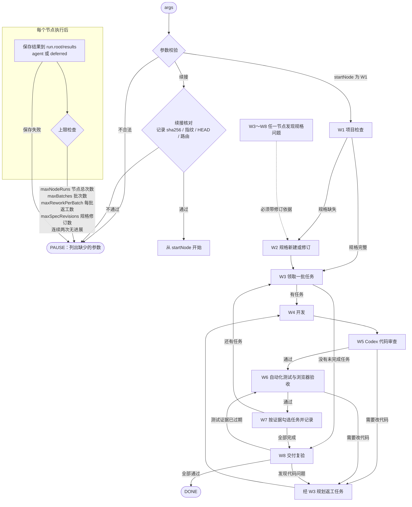

# /bowen:feature Dynamic Workflow（课程作业）

本目录是课程作业的主体：一个用 **JavaScript 编写的 Claude Code Dynamic Workflow**。它把 `/bowen:feature` 的 W1–W8 开发流程（项目检查 → 规格 → 任务 → 开发 → 代码审查 → 测试 → 记录 → 交付）写成可以执行的脚本，并加入了测试和交付复验节点。

仓库里的 TodoList（TodoFlow）只是**演示案例**：工作流在它上面完整跑过一个功能「按完成状态筛选」（`specs/todo-status-filter/`），以此说明这套流程可以真实运行。

---

## 1. 与课程 better-stack 架构的关系（如实说明）

课堂要求是「基于 better-stack 完善加入测试的工作流，做成 dynamic workflow」。根据课堂逐字稿，这里的 better-stack 指一个基于 TypeScript 的全栈架构脚手架，可以同时生成 web、server、app 等多个部分。这是我对课堂内容的理解，课程材料里没有给出更精确的名称或版本。

| 方面 | 实际情况 |
|---|---|
| 沿用的部分 | 课程的 W1–W8 节点划分与节点规则（`yd-ai-nodes/w1～w8.md`），SDD 方式拆出 requirements / design / tasks，`/bowen:feature` 命令（`.claude/commands/bowen/feature.md`）；本作业按课堂建议「先整理 command，再转成 dynamic workflow」，并加入了 W6 自动化测试和 W8 交付复验 |
| 演示项目 | TodoList **不是**用 better-stack 生成的。它基于 `site-creator-vinext-starter`（vinext + React + Vite，带可选的 Cloudflare D1 / Drizzle），只有一个 Web 应用，没有 monorepo（`apps/`、`packages/`），也没有 server 或原生 App 子项目 |
| 未完成的部分 | 工作流**没有**针对 better-stack 的目录结构做适配，也**没有**在 better-stack 生成的项目上运行过。项目相关的命令（构建、lint、浏览器启动方式）由 W1/W6/W8 从目标项目的 `package.json` 和 `AGENTS.md` 读取，所以换到其他项目时，需要先为它写好 `AGENTS.md` |

---

## 2. 文件说明

| 文件 | 作用 |
|---|---|
| `bowen-feature.js` | **入口**：W1–W8 总调度。所有节点、路由、上限和结果保存都在这一个文件里，不引用其他脚本 |
| `tools/wf_snapshot.py` | 确定性工具：快照与比较、文件指纹、受保护的命令执行（guarded-run）、结果保存与续接校验。脚本以 `python3 -I workflow-examples/tools/wf_snapshot.py` 调用它，所以必须从**仓库根目录**运行 |
| `tests/dispatch-sim.mjs` | 回归测试：用普通 Node 执行 `bowen-feature.js` 里真实的调度代码，把各节点和 agent 换成模拟结果，不调用模型、浏览器或 Codex |
| `docs/workflow-contract.md` | 节点之间的接口约定（输入 `ctx`、返回格式、快照、路由与上限） |
| `bowen-hello*.js`、`bowen-project-advice-verified.js` | 入门示例：最小结构、串行、并行、流水线，以及一个只读的项目检查（见第 9 节） |

运行时，工作流还会读取仓库里的下列文件（都已经提交）：

- `yd-ai-nodes/w1-project-check.md`～`w8-delivery.md`：节点规则，各节点的 agent 会读取；
- `.claude/commands/bowen/feature.md`：命令原文，W1 会读取；
- `AGENTS.md`：项目的运行、lint、构建说明；
- `package.json`、`.gitignore`、`specs/INDEX.md`：项目配置与功能索引。

另外两类文件不是脚本必需的，但也已经提交：`yd-ai-nodes/README.md`（节点总览和 W1–W8 规则流程图），以及 `.claude/skills/*/SKILL.md`（Claude Code 会自动发现的开发技能，W4 开发页面时可能用到）。

---

## 3. 运行环境与权限

| 依赖 | 最低要求 | 作者本机版本 | 用途 |
|---|---|---|---|
| Claude Code，并开启 workflows（`/config`） | 支持 Workflow 工具的版本 | — | 运行工作流。脚本依赖运行环境提供的 `agent()`、`phase()`、`parallel()` 等全局函数，**不能**直接用 `node` 执行 |
| Python 3 | 3.7 及以上（用到 `subprocess.run(capture_output=…)`；按 3.7 语法解析能通过，但没有在低版本上实际运行过） | 3.14.7 | `wf_snapshot.py` |
| Node.js | 测试脚本：支持 ES Module 和可选链即可（建议 18 以上）；演示项目要求 ≥ 22.13.0 | v26.3.0 | `dispatch-sim.mjs`，演示项目的构建 |
| Git | 任意较新版本 | 2.46.0 | 快照工具用 `git ls-files` 列出文件；运行目录必须是 Git 仓库 |
| 项目依赖 | 先在仓库根目录执行 `npm install` | — | W6/W8 的构建、lint |
| Playwright MCP（Claude Code 中可用） | — | — | W6/W8 浏览器验收；不可用时节点会暂停 |
| Codex CLI，并已登录 | — | — | W5 代码审查。会把审查范围内的源码和规格发给外部服务，所以默认**不授权**（`options.codex.allowed: false`，此时 W5 会暂停并请求授权） |

权限方面：工作流会读写仓库里的规格和报告，并在 `run.root` 下写快照和日志；它**不会**执行 commit、push、创建 PR 或部署。

---

## 4. 从零启动：示例参数

在仓库根目录启动 Claude Code，然后让它用 Workflow 工具运行，`scriptPath` 写 `workflow-examples/bowen-feature.js`，`args` 写下面这个 JSON：

```json
{
  "feature": {
    "dir": "specs/todo-clear-completed-confirm",
    "title": "清除已完成前确认",
    "request": "点击「清除已完成」时先弹出确认，取消则不删除任何任务。"
  },
  "run": {
    "id": "r20261113-w1r1",
    "root": "/tmp/bowen-runs/r20261113-w1r1"
  },
  "startNode": "W1",
  "decisions": [],
  "options": {
    "ports": { "w6": 5179, "w8": 5180 },
    "npmTest": null,
    "typecheck": null,
    "codex": { "allowed": false },
    "limits": { "maxNodeRuns": 20, "maxBatches": 5, "maxReworkPerBatch": 2, "maxSpecRevisions": 2 }
  }
}
```

参数说明：

- **`feature.dir`**：功能规格目录，必须形如 `specs/<名称>`。`title` 用于 `specs/INDEX.md`；`request` 是需求原文，新建功能时必填。
- **`run.id`**：调用方自己起的唯一编号，例如「日期 + 节点 + 序号」。脚本不能用 `Date` 或随机数生成它，否则中断后无法恢复。它会出现在报告文件名、`RUNS.md` 和浏览器证据目录 `.playwright-mcp/<run.id>/` 中。
- **`run.root`**：本次运行的产物目录，用来放快照、命令日志和结果记录 `results/<节点>-<次数>.json`。必须是**仓库外**的绝对路径，并且要事先创建好，例如先执行 `mkdir -p /tmp/bowen-runs/r20261113-w1r1`。`/tmp` 下的内容可能被系统清理，需要长期保留就换个目录。
- **`options.ports`**：W6、W8 启动浏览器验收服务用的端口（`npx vite --config vite.pages.config.ts --port <端口>`），运行前要确认没有被占用。脚本不提供默认端口，缺失时节点会暂停。
- **`npmTest` / `typecheck`**：`null` 表示还没决定；到需要的时候，节点会暂停并请你决定，例如排除 `npm test` 时要写明理由。
- **`codex.allowed`**：是否允许 W5 调用 Codex。

上面这组参数只按 `bowen-feature.js` 的参数校验代码核对过结构（见第 7 节）；**没有用它实际从零跑过一遍完整的 W1–W8**。

---

## 5. 结果保存与续接

每个节点结束后，调度器都会把节点结果保存到 `run.root/results/<节点>-<次数>.json`，同时记下相关文件的 SHA256 指纹。如果保存失败，运行就会暂停，不会在没有记录的情况下继续。

### 5.1 默认方式（`recordMode` 不填，即 `agent`）

由一个 agent 执行 `wf_snapshot.py record` 来保存结果。一次运行可以连续执行多个节点，次数上限是 `maxNodeRuns`。

### 5.2 deferred 方式（适合结果很大的节点）

1. 在 `args.options` 里加上 `"recordMode": "deferred"`，并把 `limits.maxNodeRuns` 设为 `1`。这个模式只允许一次运行执行一个节点，否则参数校验会直接拒绝。
2. 运行 Workflow。脚本不再调用保存 agent，而是把结果原文和 sha256 放进返回值的 `pendingRecords` 里。
3. 运行结束后，Claude Code 会给出任务输出文件的路径。在仓库根目录执行：

   ```bash
   python3 -I workflow-examples/tools/wf_snapshot.py record-from-output <任务输出文件> <run.root> <run.id>
   ```

   工具会依次核对：
   - 输出文件属于这次运行（`run.root`、`run.id` 一致）；
   - 结果原文的 sha256 一致，node 和 iteration 一致；
   - 写入位置在仓库外，并且不会覆盖已有记录。

   全部通过后，它会输出 `resultPath` 和 `resultSha256`。只要有一项不通过，就一条都不保存。

### 5.3 续接下一个节点

新起一个 `run.id` 和 `run.root`，把 `startNode` 设为下一个节点，再加上：

```json
"resume": { "resultPath": "<上一步输出的 resultPath>", "resultSha256": "<上一步输出的 resultSha256>" }
```

能续接的上游如下：

| startNode | 需要的已保存结果 |
|---|---|
| W3 | W5 已接受的返工意见 |
| W4 | W3 的返工规划结果 |
| W5 | W4 的结果 |
| W6 | W5 的结果 |
| W7 | W6 的结果，另外要提供 `chain`（同一批次的 W5 和各轮 W4 证据链） |
| W8 | W7 → W8，或 W3 → FEATURE_TASKS_COMPLETE 的结果 |

W2 不能续接，要从 `revision`（修订依据）开始。

续接时，调度器会重新核对记录文件的 sha256、结果正文的完整性、记录的路由，以及当时记下的文件指纹和 HEAD。只要有变化就拒绝续接，不会用旧结果冒充当前状态。

---

## 6. 总调度流程



补充说明：

- 每个节点只能返回路由表里允许的去向，返回表外的值一律按 PAUSE 处理。
- 任何节点遇到停止条件，比如真实失败、缺少证据、需要用户决定、环境阻塞，都会返回 PAUSE，并在 `decisionsNeeded` 里说明需要你决定什么。
- W5/W6 → W4 的代码返工一律先经过 W3，规划成明确的返工任务。

---

## 7. 本地回归测试

在**仓库根目录**执行：

```bash
node workflow-examples/tests/dispatch-sim.mjs
```

- 测试会在系统临时目录里创建模拟仓库，不修改本仓库，也不调用模型、浏览器或 Codex。
- 全部通过时退出码为 0，各部分会输出「第 N 部分：x/x 通过」；只要有失败，退出码就是 1。
- 作者在 2026-11-12 用 Node v26.3.0 和 Python 3.14.7 实际运行过这条命令：退出码 0，没有 FAIL，耗时约 28 秒。

第 4 节的示例参数没有单独做成测试用例。我只是把它交给同一份调度代码（模拟 agent），确认它能通过参数校验、进入 W1。这只说明参数结构是合法的，不代表实际运行结果。

---

## 8. 已有运行案例与已知限制

### 8.1 演示案例：`specs/todo-status-filter/`（按完成状态筛选）

- 这个功能的 T1–T7 都由工作流逐节点完成。多数运行是每次一个节点（`maxNodeRuns: 1`）。过程中有多次暂停，分别由用户决定处理；工作流本身也在这个过程中修过几次，比如增加 deferred 保存方式和续接校验。所以这个案例**不是**一次不间断的全自动运行。
- 仓库里能查看的证据：
  - `specs/todo-status-filter/` 下的 requirements、design、tasks；
  - `reports/batch-04/` 下的 W5 r8、W6 r9、W7 r7 报告；
  - `reports/delivery/` 下的 W8 交付报告和更正版。
- 其余过程记录（`RUNS.md`、更早的批次报告）、命令日志、截图都只在作者本机，没有提交。
- **W8（r20261112-w8r3）的实际复验已经完成，但最终状态是 PAUSE，不是 DONE。** 具体情况：
  - AC1–AC16 本次都有新证据并且通过；
  - `npm run build` 和 `build:pages` 的退出码都是 0；
  - lint 没有新增错误，但命令退出码是 1，原因是有既有错误和排除路径；
  - `tsc --noEmit` 退出码 2，失败：3 个 Cloudflare 后端示例文件里的既有类型错误；
  - `npm test` 按决定排除，没有运行。
- 这次 PAUSE 的直接原因是分支检查发现了未提交、计划外的文件；即使没有这条，测试报告证据过期和类型检查失败也会让它停下。详见更正版交付报告。

### 8.2 已知限制

- `bowen-feature.js` 是一个约 3800 行的单文件。这样做是为了满足 Workflow 运行环境「一个脚本自包含」的要求，但阅读和维护成本都高，目前没有拆分。
- 只能在 Claude Code 的 Workflow 运行环境里执行；deferred 方式每次只能执行一个节点。
- 项目相关的命令依赖目标项目的 `AGENTS.md`。演示项目必须用 vite 启动做浏览器验收（`npm run dev` 会返回 500），这一点写在 `AGENTS.md` 中。
- 没有在 better-stack 生成的项目上运行过（见第 1 节）。
- W5 依赖 Codex CLI 和外部服务授权；没有授权或找不到 Codex 时，W5 会暂停。

---

## 9. 入门示例（Dynamic Workflow 基础）

这些示例都在 Claude Code 中实际运行过，可以用来理解脚本的基本写法：

| 文件 | 学习重点 |
|---|---|
| `bowen-hello.js` | 最小结构：`meta`、`phase`、`agent`、`return` |
| `bowen-hello-chain.js` | 串行：后一步用前一步的结果 |
| `bowen-hello-parallel.js` | 并行：`parallel()` 接收一组函数，失败的位置为 `null` |
| `bowen-hello-pipeline.js` | 流水线：多个条目各自走完多个步骤，条目之间不互相等待 |
| `bowen-project-advice-verified.js` | 只读检查项目 → 核对事实 → 给出建议（三个 agent 串行） |

写脚本的几条规则：

- 必须是纯 JavaScript，不能写 TypeScript 类型。
- `meta` 必须是纯字面量，`phases` 的标题要和 `phase()` 里的完全一致。
- 不能用 `Date.now()`、`Math.random()` 和不带参数的 `new Date()`，否则无法从中断处恢复。
- 不传 `schema` 时，`agent()` 返回字符串；传了 `schema`，返回的是校验过的对象。
