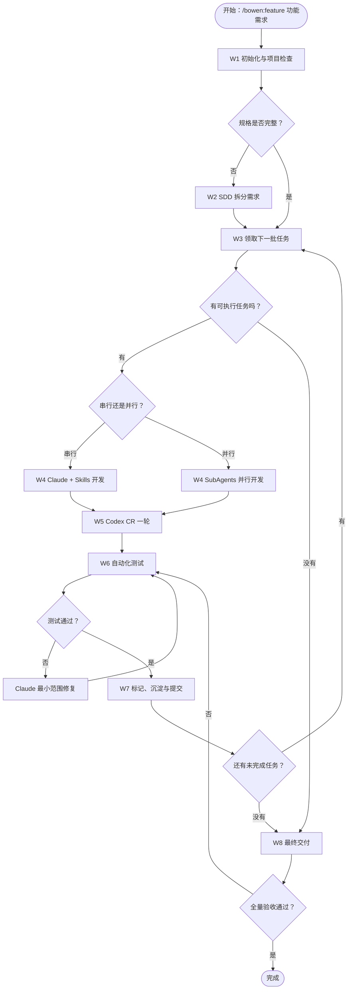

# yd-ai-nodes

本目录保存 `/bowen:feature` 工作流的节点说明。每个节点只负责一个阶段，并明确输入、动作、输出、完成条件和失败后的去向。

## 节点清单

| 节点 | 职责 | 状态 |
|---|---|---|
| W1 | 检查项目、规则、Git 和规格状态 | 已设计 |
| W2 | 整理需求、验收标准和技术设计 | 已设计 |
| W3 | 拆分并领取当前任务 | 已设计 |
| W4 | Claude 串行开发或 SubAgent 并行开发 | 已设计 |
| W5 | 调用 Codex 进行一轮 Code Review | 已设计 |
| W6 | 浏览器自动化验收，失败后修复重测 | 已设计 |
| W7 | 更新任务、沉淀经验并准备提交 | 已设计 |
| W8 | 全量回归、最终审查和交付报告 | 已设计 |

## 主流程

## 共同规则

- 先读取项目规则，再执行当前节点；
- 不覆盖用户已有的未提交修改；
- 每个节点必须产生规定的输出，才能进入下一节点；
- 测试没有通过时，不得把任务标记为完成；
- 未经用户确认，不执行远程 `push` 或部署；
- 不提交密码、Token、密钥或环境变量文件。
